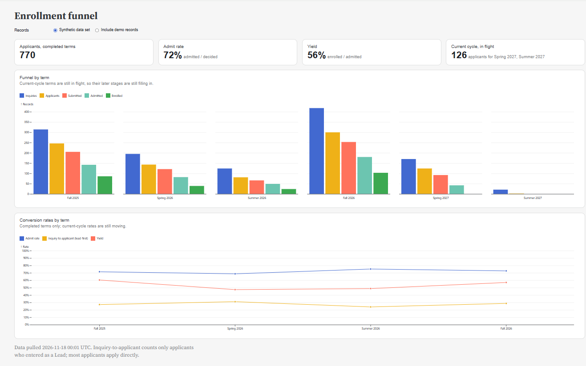
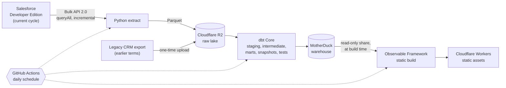
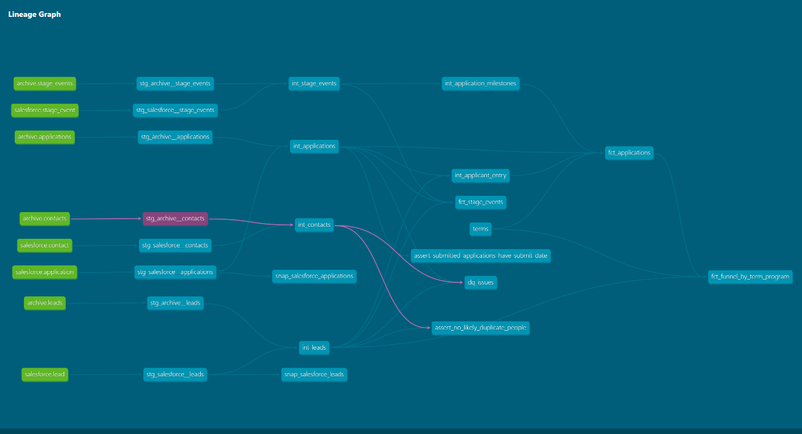
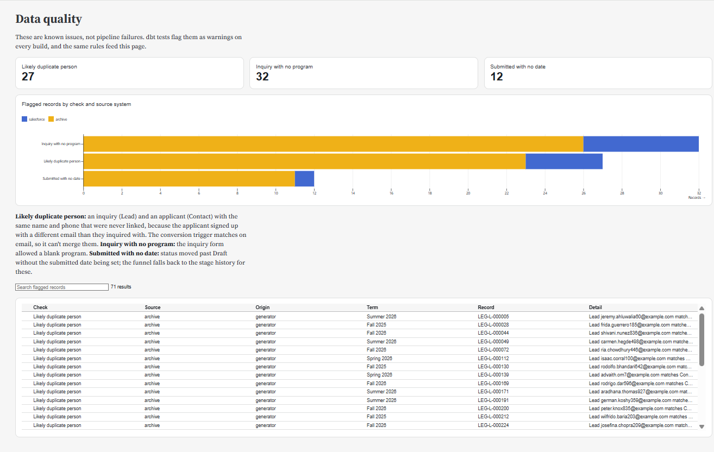
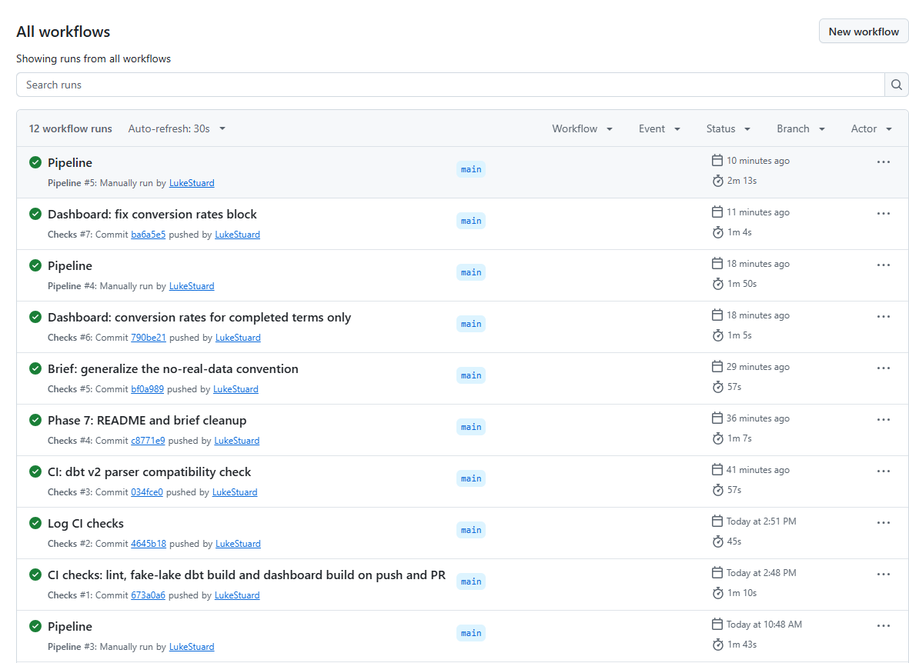
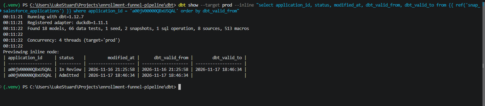

# Enrollment Funnel Pipeline

[](https://github.com/LukeStuard/enrollment-funnel-pipeline/actions/workflows/pipeline.yml)
[](https://github.com/LukeStuard/enrollment-funnel-pipeline/actions/workflows/checks.yml)

An automated ELT pipeline that turns Salesforce admissions data into a tested, version-controlled enrollment funnel: how many inquiries become applicants, admits and enrolled students, by program, term and entry path, and how long each step takes. It runs every day on free tiers, end to end, with no manual steps.

**Live dashboard:** https://enrollment-funnel-dashboard.lstua001.workers.dev

All data is synthetic. The project rebuilds the idea behind a real enrollment funnel workbook with a modern data stack; no real institution's data, names or systems are used.



## Architecture



| Layer | Tool | Notes |
|---|---|---|
| Source | Salesforce Developer Edition | Custom Application and Stage Event objects, Lead conversion by Apex trigger |
| Extract | Python, Bulk API 2.0 | Incremental on SystemModstamp, includes deletes |
| Lake | Cloudflare R2 (Parquet) | One folder per object per run; raw text columns |
| Transform | dbt Core 1.12, dbt-duckdb | Sources, staging, intermediate, marts, SCD Type 2 snapshots, tests |
| Warehouse | MotherDuck (prod), DuckDB (dev and CI) | Same models, three targets |
| BI | Observable Framework | Python data loaders query the warehouse at build time; the site is static |
| Hosting | Cloudflare Workers static assets | No server code |
| Orchestration | GitHub Actions | Daily pipeline run, plus checks on every push and pull request |

## How it works

### 1. Source: Salesforce

The funnel starts in a Salesforce Developer Edition org:

- **Inquiry:** a Lead, with program and term of interest.
- **Applicant:** a Contact with an Application (Draft, Submitted, In Review, Admitted, Denied, Enrolled, Withdrawn).
- **Stage history:** a custom Stage_Event__c object, one record per stage change. Apex triggers log new changes as they happen.

Lead conversion is real, not simulated. When an Application is created, an after-insert trigger looks for an open Lead with the applicant's email and converts it into the existing Contact, the same pattern a production admissions org would use.

Applicants arrive two ways, as they do in real admissions:

- **Lead-first (40%):** inquiry, then portal signup, then Application. The trigger converts the Lead.
- **Direct (60%):** signup and Application with no prior inquiry.

### 2. Synthetic data

A seeded generator (Python, Faker) produces about 900 applicants across seven terms (Fall 2025 to Fall 2027), with realistic conversion rates, time lags and program mix. The same seed always produces the same data.

It also injects known data quality defects, so the tests have something real to catch:

- Some lead-first applicants sign up with a different email, so the trigger can't match them and they look like two different people.
- Some Leads have no program of interest.
- Some submitted Applications have no submitted date.

**Split by time.** Developer Edition has 5 MB of data storage, about 2,500 records for the whole org. So only the current admissions cycle lives in Salesforce (about 1,200 records). Earlier terms are generated as a legacy CRM export, with its own column names and keys, and land in R2 directly. dbt unions the two sources into one shape. This mirrors a real migration: the new CRM holds the current cycle, and history lives in the old system's export.

### 3. Extract

`extract/salesforce_extract.py` runs a Bulk API 2.0 `queryAll` job per object:

- **Incremental:** the watermark is the newest SystemModstamp already in the lake, minus a 10-minute lookback, so records committed late aren't missed. Overlapping rows are expected and deduplicated in dbt.
- **Deletes included:** `queryAll` returns deleted rows with `IsDeleted = true` until Salesforce purges them. The first full extract found 2,182 deleted Leads from earlier test loads; staging filters them out.
- **Raw and append-only:** each run writes `salesforce/<object>/extracted_at=<UTC>/data.parquet` with all columns as text, exactly as the API returned them. Types are applied in dbt.
- **Least privilege:** it runs as a dedicated integration user through OAuth client credentials. See [Security model](#security-model).

### 4. Transform: dbt

| Layer | Models | Purpose |
|---|---|---|
| Staging | 8 views, 4 per source | Latest version of each record, deletes removed, types applied, emails normalized, both sources mapped onto one shape |
| Intermediate | 6 views | Union both sources, tag each applicant lead-first or direct, first time each application reached each stage |
| Marts | 4 tables | `fct_applications`, `fct_stage_events`, `fct_funnel_by_term_program`, `dq_issues` |
| Snapshots | 2 | SCD Type 2 history of Salesforce Applications and Leads |
| Seed | `terms` | Term calendar: start dates, ordering, academic year |



**Tests** come at two levels:

- **Hard failures** for pipeline bugs: unique and not-null keys, accepted values for every status and stage, relationships between applications, contacts, leads and events, and one row per term and program in the funnel mart.
- **Warnings** for known data quality issues: likely duplicate people (same name and phone, never linked), Leads with no program, submitted applications with no date. They describe the data rather than the code, so they're reported on every build without failing it, and the dashboard's Data quality page uses the same rules, so its counts always match the warnings.

The duplicate test found exactly the injected email mismatches.

**Two independent histories.** Stage_Event__c is the source system's history. The dbt snapshots are the warehouse's own: each run compares current records to the last captured version and records any change with `dbt_valid_from` and `dbt_valid_to`, whether or not the source kept history.

### 5. Dashboard

Observable Framework builds a static site. Its Python data loaders query the marts once, at build time, and the published site holds only the resulting CSVs. The browser never connects to the warehouse.

Pages: funnel overview, programs, entry paths (lead-first vs. direct), time between stages, and data quality. An origin toggle switches between the synthetic data set and records created by other demo projects in the shared org.

The applications data the site publishes has no names, emails or phone numbers.



### 6. Orchestration

Two GitHub Actions workflows:

- **[Pipeline](.github/workflows/pipeline.yml)** runs daily and on demand: extract, source freshness, `dbt build` against MotherDuck, dashboard build, deploy. A full run takes about 2 minutes. GitHub emails on failure.
- **[Checks](.github/workflows/checks.yml)** runs on every push to main and every pull request, with no secrets and no deploy. It lints the Python (ruff), confirms the dbt project parses under the dbt v2 parser, builds a fake data lake from the seeded generator, runs the full `dbt build` and freshness checks against a throwaway local DuckDB, and builds the dashboard from that file.

The two cover different things. Checks proves the pipeline's internals still fit together after a code change, using fake data shaped exactly like the real lake (its test results match production: the same three warnings with the same counts). Pipeline proves the connections to the outside services work, with real data.



## Proof: a live change, end to end

To confirm the pipeline and the snapshots work on real changes, one generator Application was moved from In Review to Admitted in Salesforce, and the Pipeline workflow was run. The snapshot recorded both versions:

| application_id | status | dbt_valid_from (UTC) | dbt_valid_to (UTC) |
|---|---|---|---|
| a00jV00000QBxU5QAL | In Review | 2026-11-16 21:25:58 | 2026-11-17 18:46:34 |
| a00jV00000QBxU5QAL | Admitted | 2026-11-17 18:46:34 | |

The old version closed at the exact second the new one opened: the record's SystemModstamp from the Salesforce edit. The change traveled from Salesforce through the extract, R2 and dbt into the warehouse's history, and the dashboard rebuilt and redeployed in the same run.



## Security model

Every component gets its own identity with only the access it needs.

| Component | Identity | Access |
|---|---|---|
| Extract | Salesforce integration user via an External Client App (client credentials, `api` scope only) | Read-only on 4 objects (plus Account, which Contact requires) and 20 fields; no create, edit or delete. Verified: an ungranted field returns INVALID_FIELD and creating a Lead is refused |
| Lake | R2 API token | Object read, write and list on one bucket only |
| Transform | MotherDuck service account | Read/write on the warehouse database, which it owns |
| Dashboard build | Second MotherDuck service account | Reads a restricted, read-only share of the warehouse; owns no data, and CREATE is refused |
| Deploy (CI) | Cloudflare custom API token | Workers Scripts edit and Account Settings read, one account only |

**Secrets:**

- No credential is in the repo. `dbt/profiles.yml` is committed because every credential in it comes from an environment variable.
- Locally, secrets live in Windows Credential Manager and are loaded into the session by `scripts/Use-FunnelEnv.ps1`, never written to disk.
- In CI, they're GitHub repository secrets, passed to the individual steps that need them rather than the whole job, so third-party npm install scripts can't read them. The deploy token is separate from the local one and has fewer permissions.

## Decisions and tradeoffs

- **Observable Framework instead of Evidence.** The plan was Evidence, but its template had become a hosted product requiring an account. Observable Framework gives the same BI-as-code model as plain files and a static build.
- **dbt Core 1.12, kept v2-compatible.** dbt v2's DuckDB adapter was in beta and couldn't load the extensions needed to read Parquet from R2. The project stays on 1.12, and CI runs the v2 parser on every push, so a future migration is a version change rather than a rewrite.
- **MotherDuck from day one.** Snapshots need state that persists between CI runs, so a hosted warehouse was required. A local DuckDB file runs the same models for development and CI.
- **A whole-database share for the dashboard.** MotherDuck Lite doesn't offer read scaling tokens (which are read-only) or shares filtered to one schema, so the dashboard's account can read the whole (synthetic) database through its share. The loaders query the marts only.
- **R2 region.** MotherDuck reads R2 from its own cloud engine, which sent its default AWS region; R2 rejects that. `region: auto` on the R2 secret fixed it.

The full build log, including what broke and how it was fixed, is in [docs/PROGRESS-funnel.md](docs/PROGRESS-funnel.md). The original plan is in [docs/BRIEF-funnel.md](docs/BRIEF-funnel.md).

## Repository layout

```
force-app/          Salesforce metadata: objects, fields, triggers, permission sets, layouts
generator/          Seeded synthetic data generator, Bulk API loader, cleanup script
extract/            Salesforce extract to R2, one-time archive upload, shared R2 connection
dbt/                dbt project: models, snapshots, seeds, tests, macros, profiles
dashboard/          Observable Framework app and its Python data loaders
ci/                 Fake data lake builder for the checks workflow
scripts/            PowerShell helpers that load credentials from Windows Credential Manager
.github/workflows/  Pipeline (daily) and Checks (push and pull request)
docs/               Project brief and build log
```

## Running it

The full pipeline needs a Salesforce org with the metadata in `force-app/`, an R2 bucket, a MotherDuck account and a Cloudflare account, with credentials in these environment variables:

`SF_INSTANCE_URL`, `SF_CLIENT_ID`, `SF_CLIENT_SECRET`, `R2_ACCOUNT_ID`, `R2_ACCESS_KEY_ID`, `R2_SECRET_ACCESS_KEY`, `MOTHERDUCK_TOKEN`, `DASHBOARD_MOTHERDUCK_TOKEN`, `CLOUDFLARE_API_TOKEN`

The steps match the Pipeline workflow:

```bash
pip install -r requirements.txt
python extract/salesforce_extract.py
cd dbt && dbt build --target prod
cd ../dashboard && npm ci && npm run build && npx wrangler deploy
```

**Without any accounts**, the checks run locally against fake data, the same way CI does:

```bash
pip install -r requirements-dev.txt
python ci/build_test_lake.py --out ci-lake
cd dbt
dbt build --target ci --vars "{raw_root: $(pwd)/../ci-lake}"
```

Python 3.13 and Node 24 are what CI uses.
